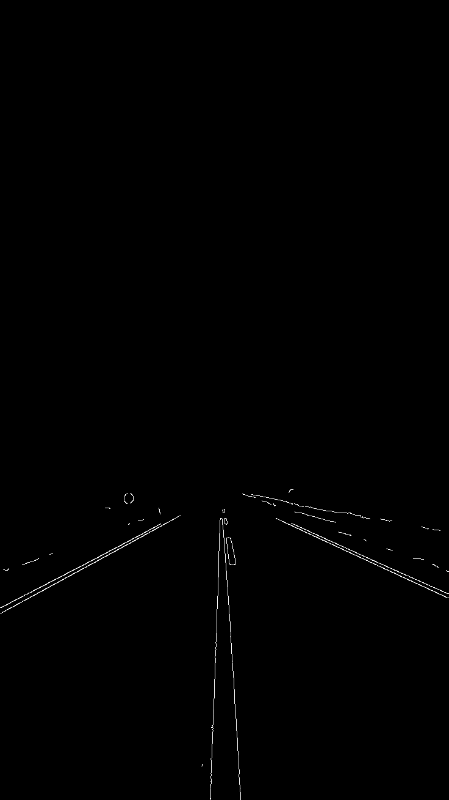
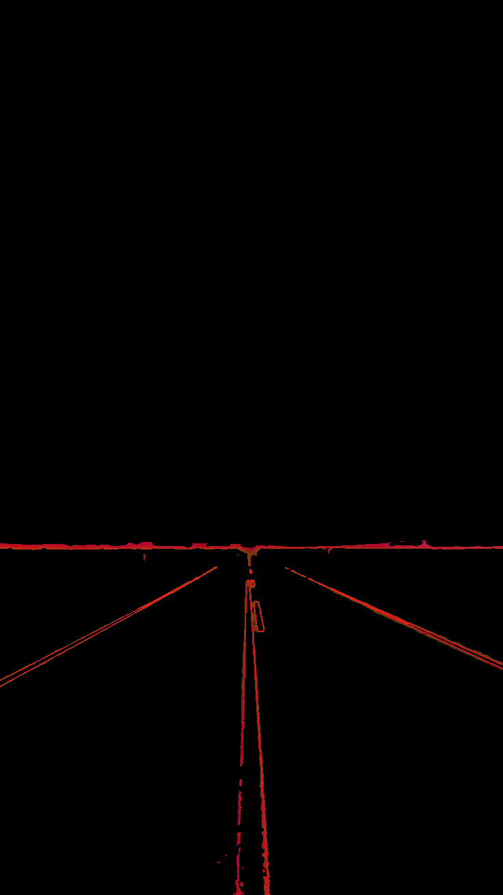

# TASK ceamTaskPhase-weekTwo (HSV Only)

    This is for Ceam Task Phase - Week 2 assignments.

<br>

## Whole Pipeline
    - Load BGR static images

    - Convert BGR to HSV

    - Separate Hue, Saturation and Value from the HSV
    
    - Apply Gaussian Blur to Value and Saturation

    - Apply Canny Edge Detection to Gaussian Blur of Value.

    - Mask Canny of Value with the HSV image.

    - Mask Gaussian Blur of Saturation with the HSV image.

    - Bitwise both of the masked images together

<br>

### BGR Image
```
img = cv.imread('road.jpg')
cv.imshow('ROAD',img)
```


<br>

### HSV Image
```
hsv = cv.cvtColor(img, cv.COLOR_BGR2HSV)
cv.imshow('HSV',hsv)
```


<br>

### GRAY Image
```
gray = cv.cvtColor(img, cv.COLOR_BGR2GRAY)
cv.imshow('GRAY',gray)
```


<br>

### Gaussian Blur Image (GRAY)
```
blur = cv.GaussianBlur(gray, (7,7), 0)
cv.imshow('BLUR', blur)
```


<br>

### Canny Edge Detection (BGR)
```
edge = cv.Canny(blur, 200, 255)
cv.imshow('CANNY EDGE', edge)
```


<br>

### Masked Image (HSV) - Color Filters
```
mask = cv.inRange(cv.GaussianBlur(hsv, (9,9), 0), np.array([0,0,110]), np.array([60,60,200]))
result = cv.bitwise_and(hsv, hsv, mask=mask)
cv.imshow('MASKED', result)
```


<br>

### Contours Drawn on Image (BGR)
```
contours, hierarchy = cv.findContours(edge, cv.RETR_LIST, cv.CHAIN_APPROX_SIMPLE)
cv.drawContours(img, contours, -1, (0,0,255), 3)
cv.imshow('CONTOURS IMG', img)
```


<br>

### OTHER REFERENCES
[README.md - Youtube](https://www.youtube.com/watch?v=jeOfS90Flf8)\
[HSV Colorspace - Youtube](https://www.youtube.com/watch?v=VvTA-yHhtQ4)\
[GRAYSCALE Transformation - Guide](https://medium.com/@niiicolai/digital-image-processing-grayscale-442461769fd2)\
[CONTOURS Detection - Guide](https://www.educative.io/answers/edge-detection-vs-contour-detection-in-computer-vision)


