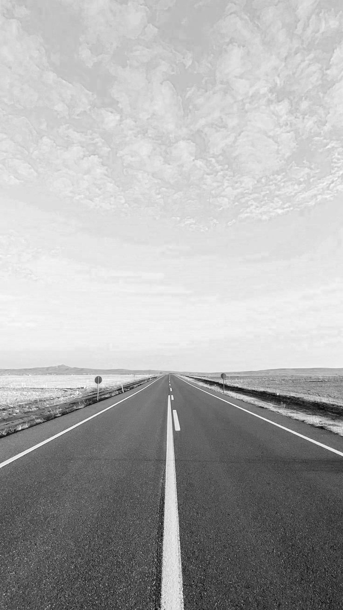
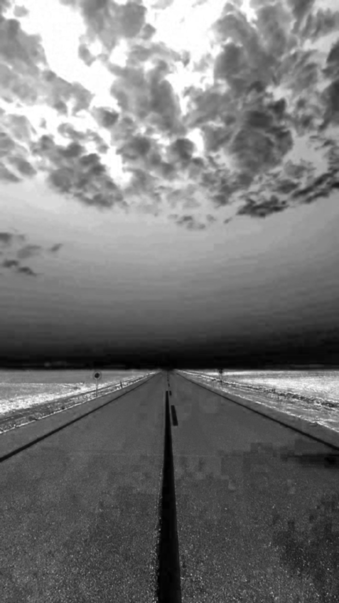
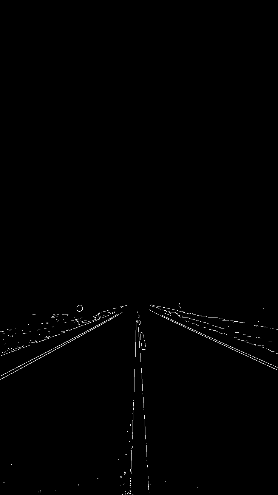
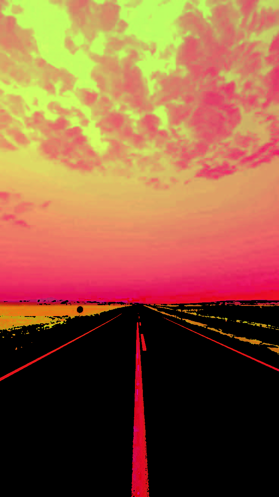
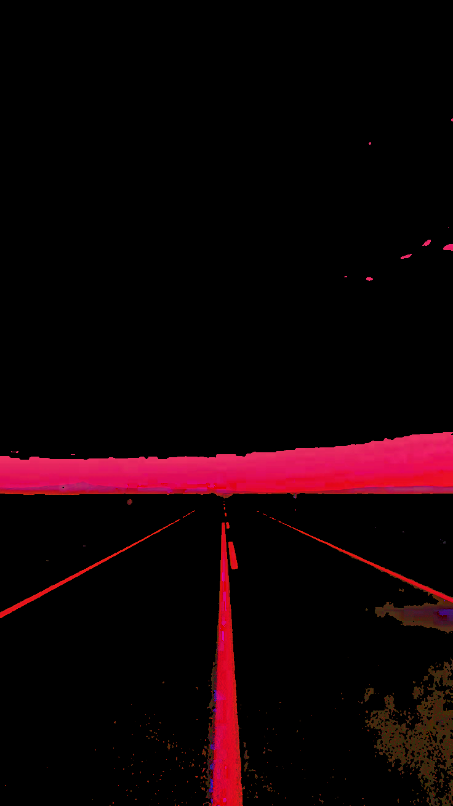
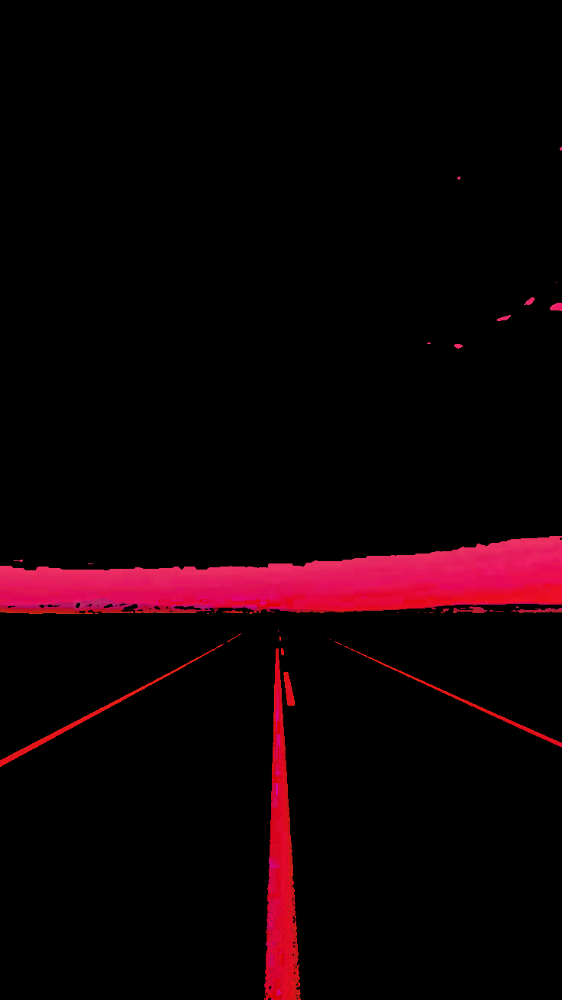

# TASK ceamTaskPhase-weekTwo (HSV Only)

    This is for Ceam Task Phase - Week 2 assignments.

<br>

## Whole Pipeline
    - Load BGR static images

    - Convert BGR to HSV

    - Separate Hue, Saturation and Value from the HSV
    
    - Apply Gaussian Blur to Value and Saturation

    - Apply Canny Edge Detection to Gaussian Blur of Value.

    - Mask Canny of Value with the HSV image.

    - Mask Gaussian Blur of Saturation with the HSV image.

    - Bitwise both of the masked images together

<br>

### BGR Image
```
img = cv.imread('road.jpg')
cv.imshow('ROAD',img)
```


<br>

### HSV Image
```
hsv = cv.cvtColor(img, cv.COLOR_BGR2HSV)
cv.imshow('HSV',hsv)
```


<br>

### SATURATION Image
```
h,s,v = cv.split(hsv)
cv.imshow('SATURATION',s)
cv.imshow('VALUE',v)
```


<br>

### VALUE Image
```
h,s,v = cv.split(hsv)
cv.imshow('SATURATION',s)
cv.imshow('VALUE',v)
```



<br>

### Gaussian Blur of Value Image
```
blurValue = cv.GaussianBlur(v, (7,7), 1)
cv.imshow('BLUR VALUE', blurValue)
```


<br>

### Gaussian Blur of Saturation Image
```
blurSaturation = cv.GaussianBlur(s, (7,7), 1)
cv.imshow('BLUR SATURATION', blurSaturation)
```



<br>

### Canny Edge Detection Image (Using the Gaussian Blur of Value Image)
```
canny = cv.Canny(blurValue, 220, 255)
cv.imshow('CANNY EDGE', canny)
```



<br>

### Masked Image of HSV With Gaussian Blur of Value Image
```
maskValue = cv.inRange(blurValue, 180, 255)
resultValue = cv.bitwise_and(hsv, hsv, mask=maskValue)
cv.imshow('MASKED VALUE', resultValue)
```



<br>

### Masked Image of HSV With Gaussian Blur of Saturation Image
```
maskSaturation = cv.inRange(blurSaturation, 0, 50)
resultSaturation = cv.bitwise_and(hsv, hsv, mask=maskSaturation)
cv.imshow('MASKED SATURATION', resultSaturation)
```



<br>

### Final Bitwise Masked Image of Both Value and Saturation
```
resultFinal = cv.bitwise_and(resultValue, resultSaturation)
cv.imshow('FINAL MASKED', resultFinal)
```



<br>


### OTHER REFERENCES
[README.md - Youtube](https://www.youtube.com/watch?v=jeOfS90Flf8)

[HSV Colorspace - Youtube](https://www.youtube.com/watch?v=VvTA-yHhtQ4)

[GRAYSCALE Transformation - Guide](https://medium.com/@niiicolai/digital-image-processing-grayscale-442461769fd2)

[CONTOURS Detection - Guide](https://www.educative.io/answers/edge-detection-vs-contour-detection-in-computer-vision)

[RGB vs HSV - Guide](https://medium.com/@venkatpendela96/rgb-vs-hsv-52e55e504120)


