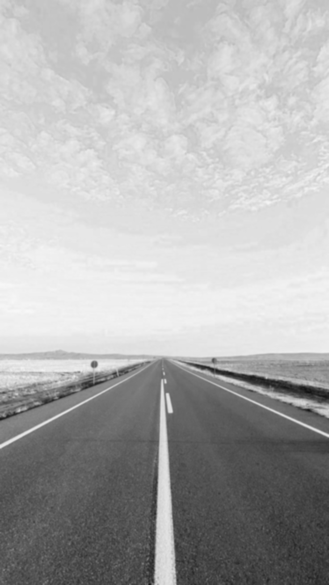
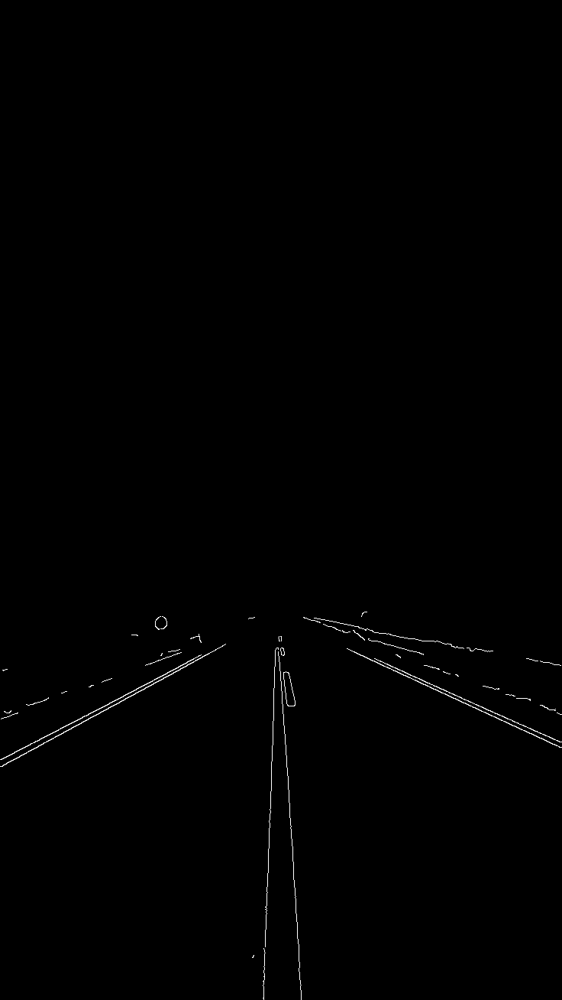
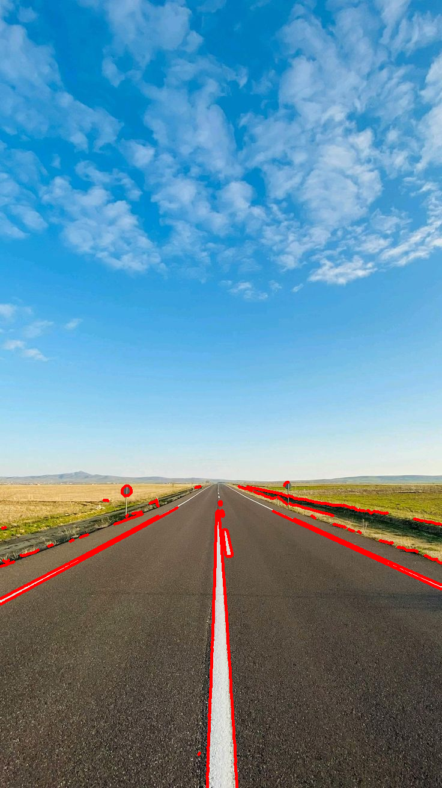

# TASK ceamTaskPhase-weekTwo (HSV Only - Follow up method)

    This is for Ceam Task Phase - Week 2 assignments.

<br>

## Whole Pipeline
    - Load BGR static images

    - Convert BGR to HSV

    - Separate Hue, Saturation and Value from the HSV

    - Apply Gaussian Blur to Value

    - Apply Canny Edge Detection to Gaussian Blur of Value

    - Find the Contours of the Canny Edge image

    - Draw the Contours on the BGR image.

<br><br>

### BGR Image
```
img = cv.imread('road.jpg')
cv.imshow('ROAD',img)
```


<br><br>

### HSV Image
```
hsv = cv.cvtColor(img, cv.COLOR_BGR2HSV)
cv.imshow('HSV',hsv)
```


<br><br>

### Value Image
```
h,s,v = cv.split(hsv)
cv.imshow('VALUE',v)
```


<br><br>

### Gaussian Blur of Value Image
```
blur = cv.GaussianBlur(v, (7,7), 0)
cv.imshow('BLUR',blur)
```


<br><br>

### Canny Edge of Gaussian Blur (Value Image)
```
canny = cv.Canny(blur, 200, 255)
cv.imshow('CANNY EDGE', canny)
```


<br><br>

### Contours on the BGR Image
```
contour, hierarchy = cv.findContours(canny, cv.RETR_LIST, cv.CHAIN_APPROX_SIMPLE)
cv.drawContours(img, contour, -1, (0,0,255), 4)
cv.imshow('CONTOURS IMG', img)
```
